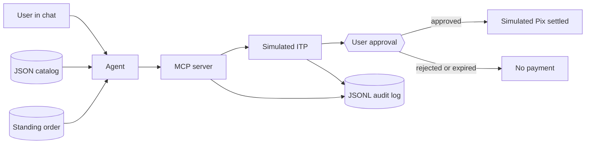

[Português](README.md) | [English](README.en.md)

# Agentic checkout with Pix

A fictional store an agent can buy from in chat, with a simulated Pix payment that moves only after the user confirms.

An AI product case: the payment page steps aside, the conversation builds the order, and simulated money moves only with the user in the loop.

Author: Renan R. Rosa, Staff Product Manager | Payment Infrastructure | Pix · Open Finance · BaaS · AI, https://www.linkedin.com/in/renanrrosa

Status: prototype · 100% fictional data

LinkedIn post: [A CONFIRMAR]

Series: case 1 of a series on AI agents in finance · previous: none · next: [A CONFIRMAR]


## 1. Problem

"Buy the usual coffee" is already an order. Brazilian checkout, as people still meet it, sends them to a page: pick a method, check the amount, confirm. An agent can parse the sentence. A small store still lacks a stable contract the agent can read, and a hard stop before any debit.

- HTML storefronts change layout, and the agent loses price, stock, and the return rule. I did not measure how many stores publish a machine-readable feed. [A CONFIRMAR] if we ever cite that coverage.
- Pix is already a checkout rail at scale, and the chat still does not close the purchase by itself. The market figure is under "Why now", with the source. Cart abandonment is not in this case: I did not measure it.
- If the agent's tool settles in the same call, the person loses the moment to check amount and receiver.

Product question: can a small Brazilian store be bought by an agent, over Pix, with the account holder's authorization outside the model's reach?

Why now:

- On 21 May 2026 Let's Money reported that Iniciador launched an agentic-payments MCP over Pix, with biometric approval on every transaction, and described it as the first in Brazil. On 22 August 2026 Golber wrote that in July 2026 the flow reached WhatsApp with Tyxter. The May article does not mention Tyxter or July. [A CONFIRMAR] against a primary note from Iniciador or Tyxter.
- Let's Money and Golber attribute to EBANX (Beyond Borders 2026) a 44% checkout share for Pix against 41% for cards. Let's Money says "44% of checkout in the country, against 41% for cards". Golber says "44% of checkouts against 41% for credit cards". The EBANX primary report is not in this repo. [A CONFIRMAR] the link and the exact wording.
- BCB Normative Instruction 746/2026 changes the default R$ 500 cap. Jornal Contábil (18 June 2026) says the norm removes that per-transaction cap for Pix by proximity and for the no-redirect journey (Jornada sem Redirecionamento), with institutions adapting by 1 October 2026. Golber describes the norm taking effect on 1 October 2026, Pix Automático inside daily-limit change requests, and the end of the R$ 500 daily cap on Pix by proximity. Those are not the same claim. The text on the Central Bank site is [A CONFIRMAR]. This case does not pick one reading as fact.

The product reference is payment initiation with the account holder confirming, in the spirit of the no-redirect journey: a third party requests, the person authorizes at their own institution. This repo does not describe an employer, an internal system, or a production journey.


## 2. Solution

Café Aurora, a fictional shop, publishes a JSON catalog and an MCP checkout. The person says "buy the usual coffee". The agent reads the standing order, builds the cart, and opens initiation. Simulated Pix reaches `settled` only after an explicit approval.

1. Trigger: the sentence in chat.
2. The agent reads `examples/catalog.json` and `examples/habitual-order.json` through the MCP server tools.
3. The agent builds the cart (200ml filter coffee and bread on the griddle, R$ 14.50) and calls `start_checkout`. The intent sits in `awaiting_user_approval`.
4. The person approves or rejects on the simulated ITP. In place of biometrics, the demo requires the phrase `CONFIRMO O PIX` and the method `simulated_biometric`.
5. On approval, the mock mints a fake `endToEndId` and writes the `approval_id` to the audit log. With no approval, settlement is refused. If the deadline passes, the state becomes `expired`.


1080x1350 version of the same journey, for a post: [docs/assets/jornada-1080x1350.png](docs/assets/jornada-1080x1350.png).

## 3. Architecture



The agent sees six tools: `list_catalog`, `get_habitual_order`, `upsert_cart`, `get_cart`, `start_checkout`, `get_payment_status`. Approval and settlement live on the simulated ITP's local HTTP server (`127.0.0.1`, port 8787 by default). The checkout response shape is `template/checkout-response.schema.json`. States are documented in `docs/estados.md`.

### Principles

- Least privilege. The agent reads the catalog, replaces the cart, and creates the intent. Settlement is not in the tool list. `DEMO_MODE=false` exits the process.
- Human in the loop. `approved` only comes from `POST /consents/:id/decision` with method `simulated_biometric` and the right phrase. Otherwise `settle` returns `approval_required` and the status stays put.
- Traceability. The `payment_settled` event in the JSONL carries the `approval_id` stored on `user_biometric_approved`. The test fails if they differ.
- Do not invent. An unknown SKU, an unavailable item, or a price sent by the agent returns an error. In the prompt, a missing fact comes back as `[A CONFIRMAR]`.
- Privacy by default. Fixtures have no CPF (Brazilian tax id), email, phone, or real Pix key. The log does not store the phrase, only whether it matched. See `docs/privacidade.md`.

## 4. Results

| Dimension | Before | After |
| --- | --- | --- |
| Contract for an agent to buy | A page a human fills in | Six MCP tools, stable JSON, price taken from the catalog |
| Settlement without approval | A single tool could debit in the same call | Refused. The demo and the suite call `settle` while status is `awaiting_user_approval` |
| Record of who authorized | [A CONFIRMAR] for a page checkout, outside this prototype | Every `payment_settled` points at the user's `approval_id` |
| Personal data in the output | Risk of a CPF or a secret in a sloppy sample | The suite scans the demo output and the fixtures |
| Conversion, time, GMV | not measured | not measured |

### How I measured

- Test base: the fictional Café Aurora catalog, one standing order (filter coffee and bread on the griddle), and the paths for approve, reject, expire, wrong phrase, a method that is not biometric, idempotency, and an invalid SKU.
- Primary metric: `settled` happens only with an `approval_id`, and that id is the one on `user_biometric_approved`.
- Comparison: a settle call before approval, which the simulated ITP refuses with HTTP 409 and records `settle_blocked`.
- Limits: no real payment, no outside user, biometrics reduced to a phrase, no device, no Open Finance participant, no measure of human time or conversion.

## 5. Lessons

1. **The intent and settlement are separate steps.** The first cut of this prototype returned a completed payment from checkout. I removed settlement from the agent's tool. `start_checkout` stops at `awaiting_user_approval`.
2. **Confirmation stays outside the model's context.** An `approved: true` argument would be the model filling in the gate. The phrase `CONFIRMO O PIX` exists only on the simulated ITP's local API.
3. **A consent with no deadline hangs open.** The `expired` state exists so a late approval finds the door shut. The demo default is 3 minutes.
4. **An audit trail without the approval id does not prove authorization.** The test requires `payment_settled.approval_id` to be the id stored when the user approved.

## 6. Risks and limits

- Local simulation. No call to SPI, the participant directory, or an ITP certificate.
- "Biometrics" is a fixed phrase. No fingerprint, face, or device.
- Fraud checks, daily limits, MED (Pix's special refund mechanism), refunds, scheduling, and production retries are out. Idempotency covers a retry of the same key, and nothing else.
- The agent can pick the wrong item. This prototype's mitigation is the cart summary in the response, before approval. There is no measurement of model accuracy.
- The real no-redirect journey has consent, deadline, and channel rules this mock simplifies. The design takes that journey as a reference.
- Anyone with access to the machine can reach `127.0.0.1`. The bind is local-only, not an access control.
- Left out on purpose: production, many stores, a recurring mandate, WhatsApp, and a regulated ITP.

## 7. Next steps

- Record the journey in Claude Desktop with the prompt in `prompts/agente-checkout.md`. [A CONFIRMAR] the video script.
- Connect an initiation sandbox if there is an institution and an environment. [A CONFIRMAR] which ITP and which API. The gap list is in `docs/como-replicar.md`.
- Set a per-transaction cap, and define what a recurring mandate would be without skipping confirmation on each debit.
- Publish the post for this case. [A CONFIRMAR] the link.

## How to run

Demo mode (no credentials):

```bash
npm install
npm test
npm run demo
```

On a fresh clone, one command: `./scripts/demo.sh`

The demo prints the conversation and writes the audit log to `examples/output/audit.jsonl`. Success is a final status of `settled` with an `approval_id`, after a refused settlement.

Claude Desktop setup: `docs/claude-desktop.md` (written in Portuguese).

With real data: see `docs/como-replicar.md`. Copy `.env.example` to `.env` and fill it in. In this repo the sample file only sets `DEMO_MODE=true`. There is no real credential to add.

## Layout

| Path | What it is |
| --- | --- |
| `docs/` | Decisions, states, privacy, Claude Desktop, and what a real replica would take |
| `docs/assets/` | Case figures. `capa-repo-1280x640.png` is the image for GitHub's social preview (upload it by hand in the repository settings) |
| `prompts/` | Versioned agent prompt |
| `src/` | MCP server, simulated ITP, demo, and the approval CLI |
| `template/` | Fixed shape of the checkout response |
| `examples/` | Fictional catalog, standing order, and customer. Demo output goes to `examples/output/`, which is gitignored |
| `tests/` | States, checkout, HTTP, MCP, demo, and the personal-data scan |

## Sources

- MCP, the stdio subset this server speaks: https://modelcontextprotocol.io/
- Let's Money, 21 May 2026, agentic Pix payments MCP: https://www.letsmoney.com.br/pagamentos/iniciador-lanca-o-primeiro-mcp-de-pagamentos-agenticos-via-pix/
- Golber, 22 August 2026, agentic commerce, Pix, ACP, AP2, x402, Tyxter, and BCB IN 746/2026: https://golber.net/blog/comercio-agentico-brasil-pix-acp-ap2-x402
- iMasters, URL on agentic commerce, biometric Pix, and a Getnet proposal. The article body is not copied here. [A CONFIRMAR] what it claims: https://imasters.com.br/inteligencia-artificial/agentic-commerce-e-pix-por-biometria-o-que-a-getnet-propoe-para-o-checkout-brasi
- Jornal Contábil, 18 June 2026, Pix proximity and JSR limits: https://jornalcontabil.com.br/noticia/banco-central-estabelece-novo-limite-para-o-pix-por-aproximacao/
- Official text of BCB Normative Instruction 746/2026: [A CONFIRMAR]
- EBANX Beyond Borders 2026 report: [A CONFIRMAR]

## Notice

Personal and educational project, with no tie to employers or to the vendors named above. Every data point in the repository is fictional. Nothing here is financial, credit, or investment advice. MIT license.
