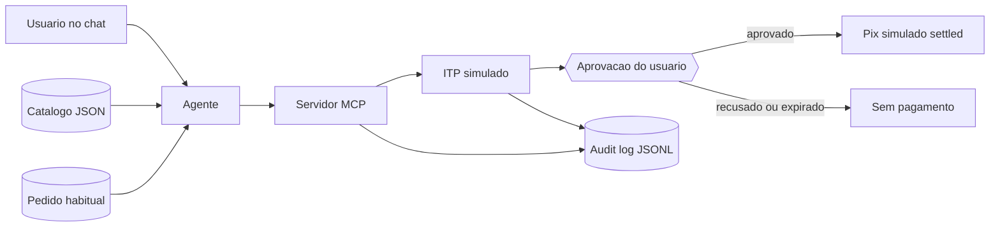

[Português](README.md) | [English](README.en.md)

# Checkout agêntico com Pix

Uma loja fictícia que um agente compra no chat, com Pix simulado só depois da confirmação do usuário.

Um case de produto de IA: a página de pagamento sai do caminho, a conversa monta o pedido, e o dinheiro simulado só anda com o usuário no circuito.

Autor: Renan R. Rosa, Staff Product Manager | Payment Infrastructure | Pix · Open Finance · BaaS · AI, https://www.linkedin.com/in/renanrrosa

Status: protótipo · dados 100% fictícios

Post no LinkedIn: [A CONFIRMAR]

Série: case 1 de uma série sobre agentes de IA em finanças · anterior: nenhum · próximo: [A CONFIRMAR]


## 1. Problema

Quem pede "compra o café de sempre" num chat já disse o pedido. O checkout brasileiro, na prática corrente, ainda empurra a pessoa para uma página: escolher o método, conferir o valor, confirmar. Um agente de IA entende a frase. Ele não tem, numa loja comum, um contrato estável para ler o cardápio e parar antes do débito.

- A vitrine em HTML muda de layout e o agente perde o preço, o estoque e a regra de devolução. Não medi quantas lojas publicam um feed legível. [A CONFIRMAR] se formos citar cobertura de catálogo estruturado.
- O Pix já é meio de checkout em escala, e a conversa ainda não fecha a compra sozinha. O número de mercado está em "Por que agora", com a fonte. Abandono de carrinho não entra aqui: eu não medi.
- Se a ferramenta do agente liquidar na mesma chamada, a pessoa perde o instante de conferir valor e destinatário.

Pergunta de produto: uma loja brasileira pequena consegue ser comprada por um agente, via Pix, com a autorização do titular fora do alcance do modelo?

Por que agora:

- Em 21/05/2026 a Let's Money publicou que o Iniciador lançou um MCP de pagamentos agênticos via Pix, com aprovação biométrica a cada transação, e descreveu o produto como o primeiro no Brasil. Em 22/08/2026 a Golber escreveu que em julho de 2026 o fluxo foi para o WhatsApp com a Tyxter. A matéria de maio não cita Tyxter nem julho. [A CONFIRMAR] em comunicado do Iniciador ou da Tyxter.
- A Let's Money e a Golber atribuem à EBANX (Beyond Borders 2026) a fatia de 44% do checkout para o Pix contra 41% do cartão. A Let's Money fala em "44% do checkout no país, contra 41% dos cartões". A Golber fala em "44% dos checkouts contra 41% do cartão de crédito". O material primário da EBANX não está neste repositório. [A CONFIRMAR] o link e a redação exata.
- A Instrução Normativa BCB nº 746/2026 mexe no limite padrão de R$ 500. O Jornal Contábil (18/06/2026) diz que a norma tira esse teto por transação no Pix por aproximação e na Jornada sem Redirecionamento, com adaptação das instituições até 1º de outubro de 2026. A Golber descreve vigência em 1º de outubro de 2026, Pix Automático no pedido de ajuste de limite diário, e fim do limite diário de R$ 500 do Pix por aproximação. As duas leituras não são a mesma. O texto no site do Banco Central fica [A CONFIRMAR]. Este case não escolhe uma delas como fato.

A referência de produto é a iniciação de pagamento com confirmação do titular, no espírito da Jornada sem Redirecionamento: um terceiro pede, a pessoa autoriza na instituição dela. Este repositório não descreve empregador, sistema interno nem jornada real de produção.


## 2. Solução

O Café Aurora, loja fictícia, publica catálogo em JSON e um checkout por MCP. A pessoa diz "compra o café de sempre". O agente lê o pedido habitual, monta o carrinho e abre a iniciação. O Pix simulado só chega a `settled` depois da aprovação explícita.

1. Gatilho: a frase no chat.
2. O agente lê `examples/catalog.json` e `examples/habitual-order.json` pelas ferramentas do servidor MCP.
3. O agente monta o carrinho (café coado 200ml e pão na chapa, R$ 14,50) e chama `start_checkout`. O intent fica em `awaiting_user_approval`.
4. A pessoa aprova ou recusa no ITP simulado. No lugar da biometria, a demo exige a frase `CONFIRMO O PIX` e o método `simulated_biometric`.
5. Com a aprovação, o mock gera um `endToEndId` fictício e grava o `approval_id` no audit log. Sem aprovação, a liquidação é recusada. Se o prazo estoura, o estado vai para `expired`.


Versão 1080x1350 da mesma jornada, para post: [docs/assets/jornada-1080x1350.png](docs/assets/jornada-1080x1350.png).

## 3. Arquitetura



O agente vê seis ferramentas: `list_catalog`, `get_habitual_order`, `upsert_cart`, `get_cart`, `start_checkout`, `get_payment_status`. Aprovação e liquidação ficam no HTTP local do ITP simulado (`127.0.0.1`, porta 8787 por padrão). O contrato da resposta de checkout está em `template/checkout-response.schema.json`. Os estados estão em `docs/estados.md`.

### Princípios

- Permissão mínima. O agente lê catálogo, substitui o carrinho e cria o intent. Liquidar fica de fora da lista de ferramentas. `DEMO_MODE=false` nem sobe o processo.
- Humano no circuito. `approved` só nasce de `POST /consents/:id/decision` com método `simulated_biometric` e a frase certa. Sem isso, `settle` responde `approval_required` e o status não muda.
- Rastreabilidade. O evento `payment_settled` no JSONL carrega o `approval_id` gravado em `user_biometric_approved`. O teste quebra se os dois não baterem.
- Nunca inventar. SKU fora do catálogo, item indisponível e preço mandado pelo agente voltam erro. No prompt, dado ausente sai como `[A CONFIRMAR]`.
- Privacidade por padrão. Fixture sem CPF, e-mail, telefone ou chave real. O log não guarda a frase, só o resultado da conferência. Detalhe em `docs/privacidade.md`.

## 4. Resultados

| Dimensão | Antes | Depois |
| --- | --- | --- |
| Contrato para o agente comprar | Página para um humano preencher | Seis ferramentas MCP com JSON estável e preço vindo do catálogo |
| Liquidação sem aprovação | Uma ferramenta única poderia debitar na mesma chamada | Recusada. O demo e a suíte cobrem a chamada de `settle` em `awaiting_user_approval` |
| Rastro de quem autorizou | [A CONFIRMAR] no checkout de página, fora deste protótipo | Cada `payment_settled` aponta o `approval_id` do usuário |
| Dado pessoal na saída | Risco de CPF e segredo em exemplo mal feito | A suíte varre a saída do demo e os fixtures |
| Conversão, tempo, GMV | não medido | não medido |

### Como medi

- Base de teste: catálogo fictício do Café Aurora, um pedido habitual (café coado e pão na chapa), e os caminhos aprovar, recusar, expirar, frase errada, método que não é biometria, idempotência e SKU inválido.
- Métrica principal: `settled` só ocorre com `approval_id` presente, e esse id é o mesmo do evento `user_biometric_approved`.
- Comparação: a chamada de liquidação antes da aprovação, que o ITP simulado recusa com HTTP 409 e registra `settle_blocked`.
- Limitações: zero pagamento real, zero usuário externo, biometria reduzida a uma frase, sem dispositivo, sem instituição participante do Open Finance, sem medida de tempo de pessoa nem de conversão.

## 5. Lições aprendidas

1. **Intent e liquidação são passos separados.** No primeiro corte deste protótipo o checkout já devolvia pagamento feito. Tirei a liquidação da ferramenta do agente. `start_checkout` para em `awaiting_user_approval`.
2. **A confirmação fica fora do contexto do modelo.** Um argumento `approved: true` seria o próprio modelo preenchendo a barreira. A frase `CONFIRMO O PIX` só existe na API local do ITP simulado.
3. **Consentimento sem prazo fica pendurado.** O estado `expired` existe para uma aprovação tardia encontrar a porta fechada. O prazo padrão da demo é 3 minutos.
4. **Auditoria sem o id da aprovação não prova a autorização.** O teste exige que `payment_settled.approval_id` seja o id gravado na aprovação do usuário.

## 6. Riscos e limites

- Simulação local. Não há chamada ao SPI, ao diretório de participantes nem a certificado de ITP.
- A "biometria" é uma frase fixa. Não há leitura de digital, face ou aparelho.
- Fraude, limite diário, MED, estorno, agendamento e retentativa de produção ficaram de fora. A idempotência cobre o retry da mesma chave, nada além disso.
- O agente pode montar o item errado. A mitigação deste protótipo é o resumo do carrinho na resposta, antes da aprovação. Não há avaliação de acerto do modelo.
- A Jornada sem Redirecionamento real tem regra de consentimento, prazo e canal que este mock simplifica. O desenho se inspira nela.
- Qualquer pessoa com acesso à máquina alcança o `127.0.0.1`. A amarra é a porta local, não um controle de acesso.
- O que este case deixa de fora de propósito: produção, várias lojas, mandato recorrente, WhatsApp e um ITP regulado.

## 7. Próximos passos

- Gravar a jornada no Claude Desktop com o prompt de `prompts/agente-checkout.md`. [A CONFIRMAR] o roteiro do vídeo.
- Ligar um sandbox de iniciação, se houver instituição e ambiente. [A CONFIRMAR] qual ITP e qual API. O mapa do que falta está em `docs/como-replicar.md`.
- Definir teto por transação e o que seria um mandato recorrente sem pular a confirmação de cada débito.
- Publicar o post deste case. [A CONFIRMAR] o link.

## Como rodar

Modo demo (sem credenciais):

```bash
npm install
npm test
npm run demo
```

Num clone novo, um comando só: `./scripts/demo.sh`

O demo imprime a conversa e grava o audit log em `examples/output/audit.jsonl`. Sucesso é o status final `settled` com `approval_id`, depois de uma liquidação recusada.

Para falar com o Claude Desktop: `docs/claude-desktop.md`.

Com dados reais: veja `docs/como-replicar.md`. Copie `.env.example` para `.env` e preencha. Neste repositório o arquivo de exemplo só tem `DEMO_MODE=true`. Não há credencial real para colocar.

## Estrutura do repositório

| Caminho | O que é |
| --- | --- |
| `docs/` | Decisões, estados, privacidade, Claude Desktop e o que seria uma réplica real |
| `docs/assets/` | Figuras do case. `capa-repo-1280x640.png` é a imagem para o social preview do GitHub (o upload é manual, nas configurações do repositório) |
| `prompts/` | Prompt versionado do agente |
| `src/` | Servidor MCP, ITP simulado, demo e CLI de aprovação |
| `template/` | Forma fixa da resposta de checkout |
| `examples/` | Catálogo, pedido habitual e cliente fictícios. A saída do demo cai em `examples/output/`, fora do git |
| `tests/` | Estados, checkout, HTTP, MCP, demo e varredura de dado pessoal |

## Fontes

- Protocolo MCP, subconjunto stdio usado pelo servidor: https://modelcontextprotocol.io/
- Let's Money, 21/05/2026, MCP de pagamentos agênticos via Pix: https://www.letsmoney.com.br/pagamentos/iniciador-lanca-o-primeiro-mcp-de-pagamentos-agenticos-via-pix/
- Golber, 22/08/2026, comércio agêntico, Pix, ACP, AP2, x402, Tyxter e a IN BCB 746/2026: https://golber.net/blog/comercio-agentico-brasil-pix-acp-ap2-x402
- iMasters, URL sobre comércio agêntico, Pix por biometria e proposta da Getnet. O texto não foi reproduzido aqui. [A CONFIRMAR] o que a matéria afirma: https://imasters.com.br/inteligencia-artificial/agentic-commerce-e-pix-por-biometria-o-que-a-getnet-propoe-para-o-checkout-brasi
- Jornal Contábil, 18/06/2026, limite do Pix por aproximação e da JSR: https://jornalcontabil.com.br/noticia/banco-central-estabelece-novo-limite-para-o-pix-por-aproximacao/
- Texto oficial da IN BCB nº 746/2026: [A CONFIRMAR]
- Relatório EBANX Beyond Borders 2026: [A CONFIRMAR]

## Aviso

Projeto pessoal e educativo, sem vínculo com empregadores ou com os fornecedores citados. Todos os dados do repositório são fictícios. Nada aqui é recomendação financeira, de crédito ou de investimento. Licença MIT.
