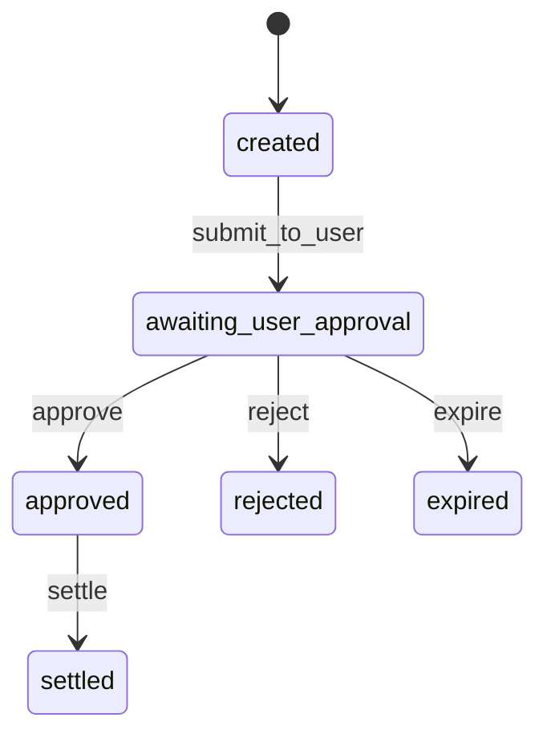

# Estados do pagamento simulado

O intent nasce no checkout e muda de estado numa ordem fechada. O nome em inglês é o valor do JSON. O nome em português é o que o demo imprime ao lado.

| Status | Significado |
| --- | --- |
| `created` | O intent existe. Ainda não foi apresentado ao usuário. No fluxo normal isso dura o tempo de gravar o log e abrir o consentimento. |
| `awaiting_user_approval` | O ITP simulado espera a confirmação. Não há débito. |
| `approved` | O usuário confirmou. Existe `approval_id`. O Pix ainda não liquidou. |
| `rejected` | O usuário recusou. Fim. |
| `expired` | O prazo do consentimento acabou enquanto estava `awaiting_user_approval`. Fim. |
| `settled` | O ITP simulado liquidou. O evento `payment_settled` do audit log carrega o mesmo `approval_id`. |

`settle` a partir de `created`, `awaiting_user_approval`, `rejected` ou `expired` é recusado. O log ganha `settle_blocked` e o status fica onde estava.

A frase `CONFIRMO O PIX` e o método `simulated_biometric` só entram na API do ITP simulado (`POST /consents/:id/decision`). Eles não são argumento de ferramenta MCP.

Prazo padrão do consentimento: 3 minutos (`CONSENT_TTL_MS` muda isso). A leitura do status, a decisão e a liquidação checam o prazo. Se já passou, o estado vai para `expired` antes de aceitar a ação.

Cada linha do `audit.jsonl` tem `ts`, `event`, `intent_id`, `consent_id`, `approval_id`, `actor` (`agent`, `user`, `itp` ou `system`), `status`, `amount_cents` e `currency`. `payment_settled` também traz `end_to_end_id`. O identificador começa com `E00000000` para deixar claro que o ISPB é fictício.
